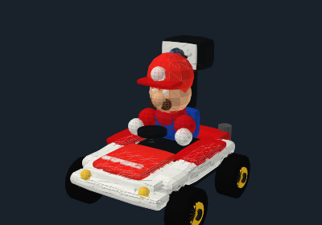

# Android 0.2.1/0.2.2 dashboard alignment

The previous Android dashboard used a green palette, duplicate driving controls,
a dense diagnostics footer, and three small instruments in one canvas. It did
not reproduce Swift 122's visual hierarchy.

This revision follows `DashboardView.swift`: a dark navy background, compact
KART LIVE header with Diagnostics / Share CSV / Network / Connect, a camera-first
left column, one driving strip below the camera, and a narrow right column.
The horizon and G-force gauges live in a scrollable upper panel; the shaded
red/white kart remains pinned below. Calibration is shared. Orientation source
selection and verbose connection/IMU details are under Advanced diagnostics.
The lower control strip scrolls horizontally on small phones; ARM and EMERGENCY
STOP are first. Fullscreen retains the joystick, A/B controls and return affordance.

The quaternion, fusion, calibration, network and motor safety paths are unchanged.
Both instrument views receive the same snapshot and clear when telemetry is stale
or disconnected. Hiding controls still sends an emergency stop.

This is a closer Android rendering of the Swift layout, not a pixel-identical
SwiftUI/SceneKit port. The kart uses shaded projected geometry rather than
SceneKit. Version 0.2.2 ports the detailed geometry from Swift's
`LiveKart3DView.swift` into `KartModel.java`: rounded bodywork, cylinder wheels
and gold hubs, seated driver, steering wheel, camera mast/lens and markers.
All geometry rotates through the shared native-to-scene quaternion, with
perspective projection, lighting and depth sorting. A desktop SVG/PNG preview
uses the production geometry/projection through lightweight Canvas adapters;
it verifies the model is drawn but is not Android screen verification.

It still needs a visual check on the user's Android device; no screenshot
or emulator execution is claimed by the client-only GitHub build.

